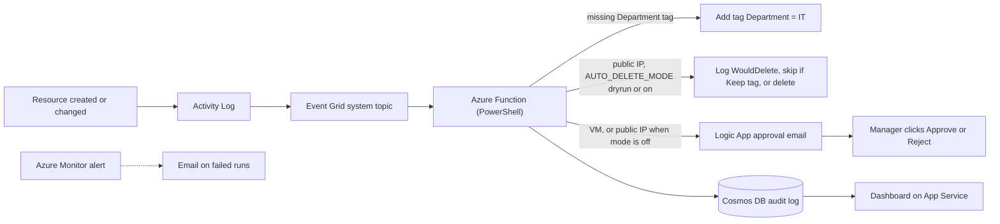

# Azure FinOps & Compliance Remediation Orchestrator

A serverless Azure project that watches a resource group, detects non-compliant resources within seconds, fixes low-risk problems automatically, asks a manager to approve risky ones, and records every action in an audit ledger with an admin dashboard.

Built by **Mohammed Shamnan** as an Azure capstone project (proposal dated 31 August 2026).

> **Status:** built and tested on Azure during the capstone. The Azure subscription has since expired, so the live dashboard is no longer available. This repository contains the code, configuration, documentation and evidence.

## The problem

In a company, people create cloud resources every day. Mistakes happen: a missing department tag (so costs cannot be allocated), a public IP address left on the internet, a virtual machine nobody reviewed. Checking by hand is slow, inconsistent and leaves no reliable history.

## What the system does

| What happens in Azure | What the system does |
|---|---|
| A resource is created or changed without a `Department` tag | Adds `Department = IT` automatically and logs it |
| A public IP address is created | Depending on `AUTO_DELETE_MODE`: `dryrun` only logs it, `on` deletes it, a `Keep = true` tag protects it, `off` sends an approval request |
| A virtual machine is created | Never touched automatically. A Logic App emails the manager with Approve and Reject buttons, and the answer is logged |
| The function fails | An Azure Monitor alert emails the administrator |
| Anything above | A record is written to Cosmos DB and shown on the dashboard |

## Architecture



More detail is in [docs/ARCHITECTURE.md](docs/ARCHITECTURE.md).

## Azure services used

| Service | Role in the project |
|---|---|
| Event Grid | Delivers resource change events from the Activity Log |
| Azure Functions | Checks the rules and applies fixes (`EventGridTrigger1`) |
| Azure Policy | Defines and reports compliance standards (tag policy, CIS benchmark audit, VM region rule) |
| Defender for Cloud | Security posture assessment (Foundational CSPM) |
| Cosmos DB | Audit ledger (`ComplianceDB` / `AuditLogs`) |
| Logic Apps | Human approval workflow by email |
| Key Vault | Stores the Logic App URL secret |
| Azure Monitor | Alerts on failed remediation runs |
| App Service | Hosts the admin dashboard |
| Container Instances | Short-lived Trivy vulnerability scan |
## Project Screenshots & Architecture

### 1. Architecture Flow Diagram


### 2. Deployed Azure Resource Group


### 3. Logic App Approval Email


### 4. Approval Response Confirmation


### 5. Azure Monitor Alert Notification


## Repository structure

```
.
├── README.md                         You are here
├── function-app/
│   └── EventGridTrigger1/            The remediation engine (run.ps1, function.json)
├── dashboard/                        Flask admin dashboard (app.py, requirements.txt)
├── infra/
│   ├── role.json                     Custom role: read and delete public IPs only
│   └── vm-rule.json                  Azure Policy rule: deny VMs in South Africa North
└── docs/
    ├── README.md                     Documentation index
    ├── ARCHITECTURE.md               Data flow and decision logic
    ├── SETUP-GUIDE.md                How it was built, resources, cost and clean-up
    ├── TESTING.md                    Test scenarios
    ├── SECURITY.md                   Security design and known gaps
    ├── TROUBLESHOOTING.md            Problems met and how they were fixed
    ├── LIMITATIONS-AND-FUTURE-WORK.md
    └── screenshots/                  Evidence images
```

## Where to start reading

1. This README for the idea.
2. [docs/ARCHITECTURE.md](docs/ARCHITECTURE.md) for how an event travels through the system.
3. `function-app/EventGridTrigger1/run.ps1` for the decision logic in code.
4. [docs/TESTING.md](docs/TESTING.md) and the screenshots for proof that it works.
5. [docs/SECURITY.md](docs/SECURITY.md) and [docs/LIMITATIONS-AND-FUTURE-WORK.md](docs/LIMITATIONS-AND-FUTURE-WORK.md) for an honest view of what is and is not covered.

The full written project documentation (PDF) is in the `docs` folder.

## Safety features

- Managed identities, with no stored credentials
- A custom role that can only read and delete public IP addresses, plus Tag Contributor for tagging
- Dry-run mode, a `Keep = true` tag and a kill switch for automatic deletion
- Delete locks on key resources
- Scope guard: the function ignores anything outside the project resource group
- Human approval for virtual machines
- Dashboard restricted to the administrator IP address

## Proposal versus what was built

| Proposal | Delivered |
|---|---|
| Event-driven design using Activity Log and Event Grid | Yes |
| All 10 Azure services | Yes |
| Automatic remediation | Department tag fix; public IP deletion with safeguards |
| Approval workflow (Teams or email) | Email approval; Teams is future work |
| Auditing against security benchmarks | CIS benchmark and Defender for Cloud audits are reported; their findings are not auto-fixed |
| Bicep and CI/CD | Not built (future work) |
| Private endpoints and VNet integration | Not built: the Function uses the Consumption plan, which does not support VNet integration. The dashboard is IP-restricted instead |
| Rules for public storage access and disk encryption | Not built (future work) |

## Author

Mohammed Shamnan, BCA student and cloud computing intern. GitHub: [shamnankp](https://github.com/shamnankp)
