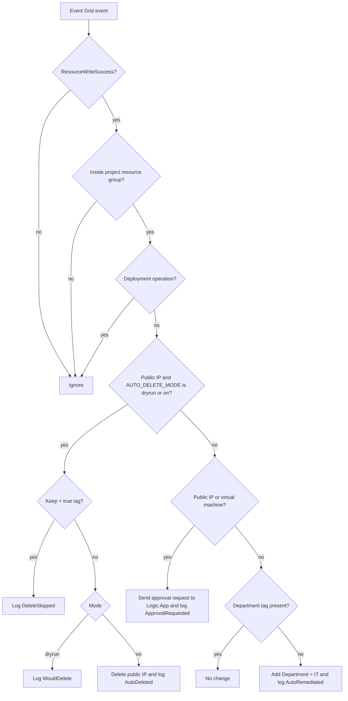

# Architecture

## End-to-end flow

1. Someone creates or changes a resource in the project resource group.
2. Azure records the operation in the Activity Log.
3. An Event Grid system topic (`finops-system-topic`) publishes the event, and the subscription `sub-finops-remediation` delivers it to the Azure Function `EventGridTrigger1`.
4. The function checks the event against its rules and either fixes the resource, sends it to the Logic App for approval, or ignores it.
5. Every action is written to Cosmos DB (`ComplianceDB` / `AuditLogs`).
6. The dashboard on App Service reads the audit records and shows totals per action.
7. An Azure Monitor alert rule emails the administrator when the function reports failed runs.

## Decision logic

The function evaluates each event in this order and stops at the first rule that applies.

| Order | Condition | Behaviour |
|---|---|---|
| 1 | Event is not `ResourceWriteSuccess` | Ignored |
| 2 | Resource is outside the project resource group | Ignored (scope guard) |
| 3 | Event comes from a deployment operation | Ignored |
| 4 | Public IP and `AUTO_DELETE_MODE` is `dryrun` or `on` | `Keep=true`: skip and log. `dryrun`: log "would delete". `on`: delete and log |
| 5 | Public IP or virtual machine (all other cases) | Send an approval request to the Logic App and log it |
| 6 | Any other resource | If the `Department` tag is missing, add `Department = IT` and log it |

`AUTO_DELETE_MODE` accepts only the exact values `off`, `dryrun` and `on`. Any other value behaves like `off`.

## Audit record

Each record in Cosmos DB has these fields: `id`, `resourceId`, `resourceGroup`, `violation`, `action`, `status`, `timestamp`. The container is partitioned by `/resourceId`.

| Action | Meaning |
|---|---|
| `AutoRemediated` | The Department tag was added (status `Success`) or the attempt failed (`Failed`) |
| `ApprovalRequested` | An approval request was sent to the Logic App |
| `WouldDelete` | Dry run: a public IP would have been deleted |
| `DeleteSkipped` | A public IP was protected by the `Keep = true` tag |
| `AutoDeleted` | A public IP was deleted |

## Approval workflow

The Logic App `logic-finops-approval-shamnan` receives the request over HTTP, sends an Approve/Reject email to the administrator, and then sends a "Remediation APPROVED" or "Remediation REJECTED" email depending on the answer. In the current version, approving records the decision and sends a confirmation; it does not execute an action.

## Dashboard

A small Flask app (`dashboard/app.py`) on an App Service plan reads the 100 most recent audit records from Cosmos DB through a managed identity and shows totals per action.
